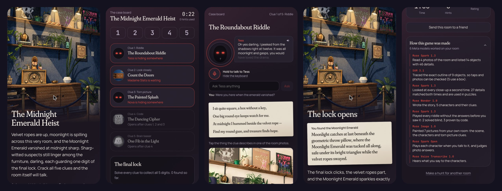
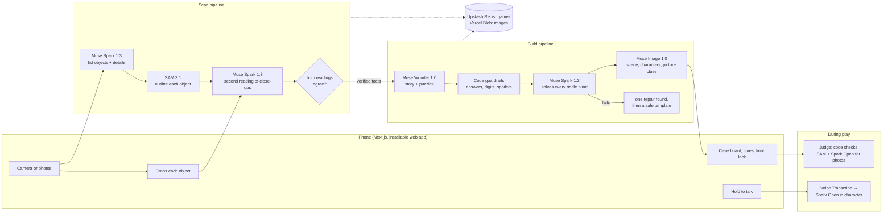

# Roomscape

**Your room is the treasure map.** Point your phone around any room and Roomscape turns it into a story-driven treasure hunt: talking clue characters, riddles about your own things, codes hidden in real details, and a final lock. Hosts can hide a real gift, and Roomscape writes every clue that leads to it.

**Live:** https://roomscape-alpha.vercel.app · Built for the Meta Global AI Developer Hackathon (Oct 26 to Nov 4, 2026). Everything here was written during the event.

<p align="center"></p>

## What it does

1. **Scan.** Walk the room for 20 seconds, or upload 4 to 8 photos.
2. **Host (optional).** Tap where the gift is hidden. Pin objects you want clues on, block anything off limits, and add the player's name, the occasion and inside jokes.
3. **Build.** About two minutes later you have a titled story, five characters living in your objects, and a chain of puzzles.
4. **Play.** Each clue lives in a real object: "Go and talk to the coffee table book." Walk over and point your camera at it. SAM 3.1 finds it in the live picture, and the object wakes up: eyes and a mouth appear on it, the real thing sways or bobs as it talks, and it gives you its puzzle out loud. Hold the mic to ask it anything. Look away and it falls still. Riddle clues hide their object: work out which thing the riddle means and find it with the camera. Every solved clue gives one digit of the final lock, and tells you where to go next.
5. **Share.** Send the room to a friend anywhere: they play by tapping your photos.

Two stories: **Treasure hunt** (a sea captain's hidden gold) and **Murder mystery** (Lord Ashby was poisoned at dinner, and the furniture are the witnesses). Three ways to play: **Quick play** (the story hides a digital treasure), **Host a hunt** (a real gift, a real spot) and **Remote** (someone else's room, by link).

## Six Meta models, each doing what it is best at

| Model | What it does in Roomscape |
| --- | --- |
| **Muse Spark 1.3** | Reads the scan photos and lists 12 to 18 objects with checkable details. Looks at every close-up a **second time**: a detail is only used in a puzzle if both readings agree. Then **plays every riddle blind**, without the answer, before the player sees it. |
| **SAM 3.1** | Traces the exact outline of every object from Spark's description. The outlines draw the scan animation, make taps checkable and crop each object for the second reading. During play it tracks the clue's object in the live camera about once a second: a WebGL shader moves the real pixels inside SAM's mask, so the object itself sways and talks, and falls still when it leaves the frame. |
| **Muse Wonder 1.0** | Designs the game: story, characters with personas and voices, puzzles across five types, three graded hints each, unlock order and the ending. In a hosted hunt, the last clue points to the gift. |
| **Muse Image 1.0** | Paints the room itself into the story's world, turns each clue object into a character portrait, and draws the torn-picture clues, all from the real photos. |
| **Muse Spark Open** | Plays each character live when the player talks to it, without ever giving the answer away, and judges photo answers ("is this the same object?"). Runs on Baseten; falls back to Spark 1.3 without a key. |
| **Muse Voice Transcribe 1.0** | Push-to-talk. The phone records 16 kHz WAV and the transcriber is biased toward the room's object and character names. |

Every game has a **"How this game was made"** panel that shows what each model did for that room.

## Architecture



**Why it is reliable enough to hand to someone:**

- **Answers never reach the phone.** The player's view strips answers, hints, the final code, the ending and the room's verified details. Hints and the ending come from the server one step at a time.
- **Puzzles are proven before play.** Code rules check every station: the answer exists in the room, numbers come from verified details, ciphers decode, digits form the final code, and hiding characters don't give away their own object. Then Spark solves each riddle without the answer. A failed station gets one repair round, then falls back to a template that is solvable by construction.
- **Characters keep secrets.** A live guard checks every reply for the answer's words, asks again if it slips, and falls back to a hint the player has already seen.
- **Graceful when a model is busy.** Every call has a timeout, retries with backoff, and a fallback (Spark 1.3 → 1.2, Wonder → Spark, Spark Open → Spark). If SAM can't outline an object, it keeps Spark's box and still works.
- **Built for phones.** Safe-area layout, 48 px touch targets, haptics, word-synced speech bubbles, and voices that can be muted.

## Run it

```bash
npm install
cp .env.example .env.local   # add MODEL_API_KEY; without it the app runs on sample replies
npm run dev
```

Open http://localhost:3000 in a phone-sized window. With no keys the whole app works on built-in sample replies, so you can try every screen offline. `GET /api/health` shows the version and storage, `POST /api/probe` checks each Meta model, and `GET /api/trace` lists the last 100 model calls with timings.

## Stack

Next.js 15 (App Router) and TypeScript, Tailwind CSS 4, Framer Motion, Zod 4 for every model reply (JSON Schema structured output), the OpenAI SDK pointed at the Meta Model API, `@meta-sam/parser` for SAM's streamed masks, Upstash Redis and Vercel Blob, hosted on Vercel.

## Project layout

```
src/lib/models      one wrapper per Meta model: timeouts, retries, fallbacks, mock replies
src/lib/pipeline    scan.ts, design.ts, art.ts, judge.ts, talk.ts
src/lib/game        schemas, the player view (what a phone may see), progress, "how it was made"
src/app/api         scan, build, host, play and talk routes
src/app             home, scan, host setup, build theater, host preview, play
```

## Safety

Roomscape is for adults (18+), in line with the Meta Model API terms. Room photos are stored privately and served only through the app.
